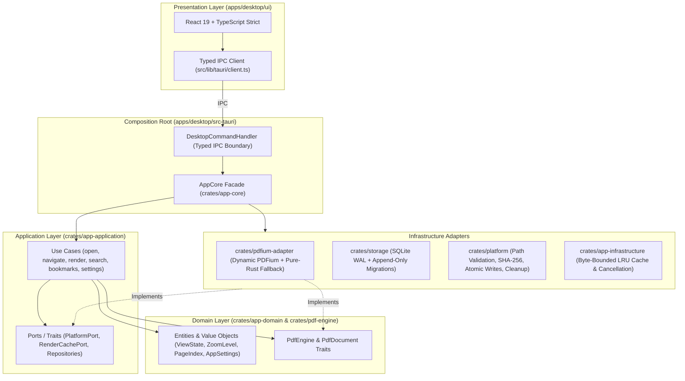

<div align="center">
  

  # Readora
  ### Calm, Local-First Desktop PDF Reader for Focused Reading

  [](Cargo.toml)
  [](apps/desktop/src-tauri/tauri.conf.json)
  [](apps/desktop/ui/package.json)
  [](THIRD_PARTY_NOTICES.md)
  [](.docs/SECURITY.md)

  **macOS** (`aarch64` / `x86_64`) · **Windows** (`x86_64`) · **Linux** (`x86_64`)
</div>

---

## Overview

**Readora** (*Focus Reader*) is a fast, privacy-first desktop PDF reader engineered for deep reading, research, and technical study. Built on a strict **Hexagonal Rust Core** paired with a tactile **React + TypeScript** presentation layer, Readora treats every PDF as untrusted input while delivering fluid continuous scrolling, memory-bounded rendering, and persistent local annotations—without cloud accounts, telemetry, or background bloat.

---

## Key Features

### 1. Fluid Reading Viewport & Precision Zoom
- **Smooth Continuous Scroll (Default) & Single-Page Modes:** Natural user-controlled continuous scrolling across stacked pages with cubic ease-out (`1 - (1 - t)^3`) programmatic page transitions, plus a classic single-page stage.
- **Responsive Zoom & Viewport Fit:** Fit Width, Fit Page, and Manual Zoom (`25%` – `500%`) with `Ctrl`/`⌘` + trackpad pinch/wheel zoom, `90°` clockwise/counter-clockwise rotation, and quantized scale buckets.
- **Adaptive Reading Themes & Color Modes:** Warm Paper (`Light`), Espresso (`Dark`), and System themes alongside **Standard**, **Grayscale**, and **Night Inversion** page render modes.
- **Byte-Bounded LRU Render Cache & Stale Cancellation:** Renders only visible pages plus a configurable prefetch window (`0`–`5` pages). Obsolete render jobs are automatically cancelled by generation token when scrolling, zooming, or switching documents.

### 2. Local Library, Collections & Reading Progress
- **Automatic State Restoration:** Every document remembers its last read page, zoom level, and rotation in local SQLite (`WAL` mode).
- **Curated Collections:** Organize documents into **All Documents**, **Favorites (Starred)**, and **Archive**, with instant title/path filtering, sorting (*Recent*, *Title*, *Progress*), and Grid or List views.

### 3. Highlights, Underlines, Comments & Markdown Export
- **Editorial Annotation Palette:** Highlight or underline passages in **Sage** (`#a9d5b2`), **Amber** (`#f1d58a`), **Sky** (`#9dc7f0`), or **Coral** (`#f2b3a3`), and attach structured page comments.
- **Bookmarks & Inspector Rail:** One-click page bookmarking, outline/table-of-contents navigation, lazy-loaded page thumbnails, and full-document text search with contextual snippets.
- **Portable Annotations Bundle Export:** Export any document’s bookmarks, highlights, underlines, and notes to a clean, atomically written Markdown bundle (`<Document>-annotations.md`).

### 4. Security-First PDF Handling
- **Untrusted Input Isolation:** Enforces maximum file-size (`512 MiB`) and pixel-dimension (`8192 px`) bounds, disables PDF JavaScript execution, and blocks automatic launching of embedded files or external attachments.
- **Zero-Leak Password Protection:** Encrypted PDFs prompt for a password on open; passwords are redacted in `Debug` implementations, never logged, and never persisted to disk.
- **Explicit Form & Digital Signature Inspection:** Transparently reports AcroForm/XFA presence and cryptographic signature fields without misleading verification claims.

### 5. GitHub Releases Update Engine & Strictly-Scoped Uninstall
- **GitHub Releases Version Verification:** Queries `https://api.github.com/repos/{owner}/{repo}/releases/latest` (configurable in **Preferences → General**), selects the matching OS installer asset, verifies SHA-256 digests and semantic versions (`major.minor.patch`), and supports deferring updates (**Later**) or staging updates for restart.
- **Clean Uninstall & Data Reset Guarantee:** Native OS uninstaller hooks (Windows NSIS, Linux `postrm`, macOS helper, and `--uninstall-cleanup` CLI flag) plus an in-app **Clean up application data & cache** action remove **only** Readora-created SQLite files and render cache entries—never touching your PDF files on disk.

---

## Architecture

Readora enforces a strict **Hexagonal (Ports & Adapters)** dependency graph where dependencies point inward toward pure domain logic:



### Workspace Crates & Modules

| Crate / Package | Layer | Responsibility |
| :--- | :--- | :--- |
| [`crates/app-domain`](crates/app-domain) | Domain | Pure domain models (`ViewState`, `DocumentDescriptor`, `Bookmark`, `Annotation`, `AppSettings`), value objects (`ZoomLevel`, `PageIndex`, `Rotation`), and SemVer comparison. Zero OS/IO dependencies. |
| [`crates/pdf-engine`](crates/pdf-engine) | Domain Port | Engine-agnostic traits (`PdfEngine`, `PdfDocument`), page geometry, and password-redacted open options. |
| [`crates/app-application`](crates/app-application) | Application | Use-case orchestration, boundary DTOs, structured `ApplicationError` codes, and port traits (`PlatformPort`, `RenderCachePort`, `SettingsRepository`). |
| [`crates/pdfium-adapter`](crates/pdfium-adapter) | Adapter | Dynamic `pdfium-render` adapter with an automatic pure-Rust fallback engine and PNG encoder. |
| [`crates/storage`](crates/storage) | Adapter | `rusqlite` (`WAL` mode) persistence for recent documents, favorites, archive state, bookmarks, annotations, and settings with append-only SQL migrations. |
| [`crates/platform`](crates/platform) | Adapter | Canonical path validation, deterministic document ID hashing, atomic file writes, GitHub Release JSON parsing, and strictly-scoped uninstall cleanup. |
| [`crates/app-infrastructure`](crates/app-infrastructure) | Adapter | Byte-bounded LRU rendered-page cache and per-document generation cancellation registry. |
| [`crates/app-core`](crates/app-core) | Composition | Wires concrete adapters behind application use cases and manages active document sessions. |
| [`apps/desktop/src-tauri`](apps/desktop/src-tauri) | Desktop Shell | Tauri 2 binary entrypoint, `--uninstall-cleanup` CLI handler, IPC command dispatcher, and native installer hooks. |
| [`apps/desktop/ui`](apps/desktop/ui) | Frontend UI | React 19 + TypeScript 5.7 strict UI aligned with the Focus Reader design system. |

---

## Getting Started

### Prerequisites

- **Rust:** Stable toolchain (`1.85+`, Edition `2024` — pinned via [`rust-toolchain.toml`](rust-toolchain.toml))
- **Node.js & pnpm:** Node.js `22+` and `pnpm` `10+`
- **Platform System Libraries (Linux only):**
  ```bash
  sudo apt-get update
  sudo apt-get install -y libwebkit2gtk-4.1-dev libappindicator3-dev librsvg2-dev patchelf rpm
  ```

### Installation & Development

1. **Clone the repository and install dependencies:**
   ```bash
   git clone https://github.com/smokeInCloud060201/readora.git
   cd readora
   pnpm install --frozen-lockfile
   ```

2. **Run the UI development server:**
   ```bash
   pnpm --dir apps/desktop/ui dev
   ```

3. **Run the full verification suite (Rust + Frontend):**
   ```bash
   # 1. Rust formatting, strict Clippy lints, and workspace unit/contract/integration tests
   cargo fmt --all -- --check
   cargo clippy --workspace --all-targets --all-features -- -D warnings
   cargo test --workspace

   # 2. Frontend ESLint, TypeScript strict typecheck, Vitest vertical-slice tests, and Vite production build
   cd apps/desktop/ui
   pnpm lint
   pnpm typecheck
   pnpm test
   pnpm build
   ```

---

## Keyboard Shortcuts

| Action | macOS | Windows / Linux |
| :--- | :--- | :--- |
| **Open / Import PDF** | `⌘ O` | `Ctrl + O` |
| **Find in Document** | `⌘ F` | `Ctrl + F` |
| **Next / Previous Page** | `↓` / `↑` or `→` / `←` | `↓` / `↑` or `→` / `←` |
| **Zoom In / Zoom Out** | `⌘ +` / `⌘ -` (or Pinch) | `Ctrl + +` / `Ctrl + -` (or `Ctrl + Wheel`) |
| **Fit Page / Fit Width / Actual Size** | `⌘ 1` / `⌘ 2` / `⌘ 0` | `Ctrl + 1` / `Ctrl + 2` / `Ctrl + 0` |
| **Highlight Selection** | `H` | `H` |
| **Add Comment** | `C` | `C` |
| **Toggle Left Sidebar** | `⌘ \` | `Ctrl + \` |
| **Toggle Notes & Details Panel** | `⇧ ⌘ \` | `Shift + Ctrl + \` |
| **Print Document** | `⌘ P` | `Ctrl + P` |
| **Preferences** | `⌘ ,` | `Ctrl + ,` |

---

## Application Data & Clean Uninstall

Readora stores its local SQLite database and render cache strictly inside OS-standard application directories and **never modifies or deletes user PDF files**:

| Operating System | Application Data (`readora.sqlite`) | Render Cache | Uninstall Mechanism |
| :--- | :--- | :--- | :--- |
| **macOS** | `~/Library/Application Support/com.readora.desktop` | `~/Library/Caches/com.readora.desktop` | In-app **Preferences → General → Clean up app data** or [`uninstall-cleanup.sh`](apps/desktop/src-tauri/installer/macos/uninstall-cleanup.sh) |
| **Windows** | `%APPDATA%\Readora` | `%LOCALAPPDATA%\Readora\Cache` | Automatic via NSIS [`nsis-hooks.nsh`](apps/desktop/src-tauri/installer/windows/nsis-hooks.nsh) on uninstall |
| **Linux** | `~/.local/share/readora` | `~/.cache/readora` | Automatic via package [`postrm`](apps/desktop/src-tauri/installer/linux/postrm) on `remove` / `purge` |

You can also invoke the native binary directly to clean up all Readora-created database and cache artifacts:

```bash
readora-desktop --uninstall-cleanup
```

---

## Documentation & Governance

- [**Architecture & Layer Boundaries**](.docs/ARCHITECTURE.md)
- [**Feature Modules & MVP Scope**](.docs/FEATURE_MODULES.md)
- [**Security & Privacy Baseline**](.docs/SECURITY.md)
- [**Build, Packaging & Release Guide**](.docs/BUILD_RELEASE.md)
- [**Testing Strategy**](.docs/TESTING.md)
- [**Coding Conventions**](.docs/CODING_CONVENTIONS.md)
- [**Agent Operating Rules (`AGENTS.md`)**](AGENTS.md)
- [**Third-Party Open-Source Notices**](THIRD_PARTY_NOTICES.md) & [**CycloneDX SBOM (`sbom.cdx.json`)**](sbom.cdx.json)

---

## License

Licensed under either of:

- **Apache License, Version 2.0** ([`LICENSE-APACHE`](THIRD_PARTY_NOTICES.md) or <http://www.apache.org/licenses/LICENSE-2.0>)
- **MIT License** ([`LICENSE-MIT`](THIRD_PARTY_NOTICES.md) or <http://opensource.org/licenses/MIT>)

at your option. See [`THIRD_PARTY_NOTICES.md`](THIRD_PARTY_NOTICES.md) for third-party component attributions.
