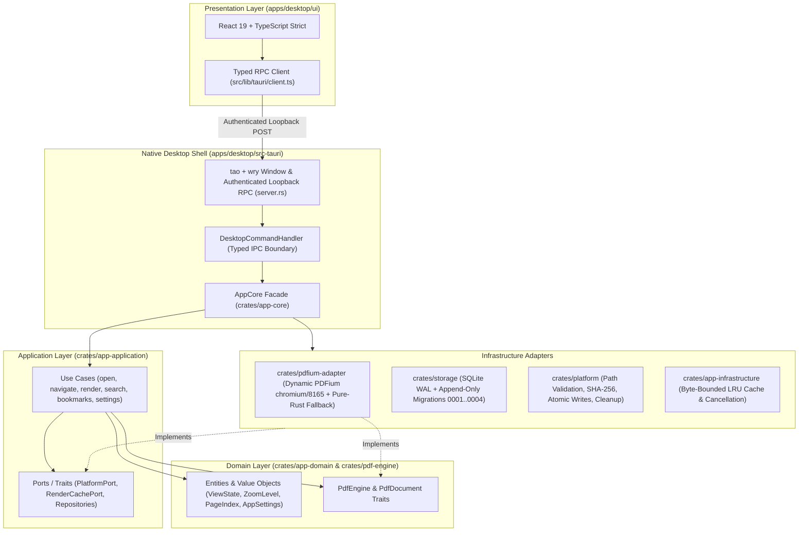

<div align="center">
  

  # Readora
  ### Calm, Local-First Desktop PDF Reader for Focused Reading

  [](Cargo.toml)
  [](apps/desktop/src-tauri/Cargo.toml)
  [](apps/desktop/ui/package.json)
  [](LICENSE-MIT)
  [](.docs/SECURITY.md)

  **macOS** (`aarch64`) · **Windows** (`x86_64`) · **Linux** (`x86_64`)
</div>

---

## Overview

**Readora** (*Focus Reader*) is a fast, privacy-first desktop PDF reader engineered for deep reading, research, and technical study. Built on a strict **Hexagonal Rust Core** paired with a native **`tao` + `wry`** desktop shell and a tactile **React + TypeScript** presentation layer, Readora treats every PDF as untrusted input while delivering fluid continuous scrolling, memory-bounded rendering, and persistent local annotations—without cloud accounts, telemetry, or background network calls.

---

## Key Features

### 1. Fluid Reading Viewport & Precision Zoom
- **Smooth Continuous Scroll (Default) & Single-Page Modes:** Natural user-controlled continuous scrolling across stacked pages with cubic ease-out (`1 - (1 - t)^3`) programmatic page transitions, plus a classic single-page stage.
- **Responsive Zoom & Viewport Fit:** Fit Width, Fit Page, and Manual Zoom (`25%` – `500%`) with `Ctrl`/`⌘` + trackpad pinch/wheel zoom, `90°` clockwise/counter-clockwise rotation, and quantized scale buckets.
- **Adaptive Reading Themes & Color Modes:** Warm Paper (`Light`), Espresso (`Dark`), and System themes alongside **Standard**, **Grayscale**, and **Night Inversion** page render modes.
- **Byte-Bounded LRU Render Cache & Stale Cancellation:** Renders only visible pages plus a configurable prefetch window (`0`–`5` pages). Obsolete render jobs are automatically cancelled by generation token when scrolling, zooming, or switching documents.

### 2. Local Library, Collections & Reading Progress
- **Automatic State Restoration:** Every document remembers its last read page, zoom level, and rotation in local SQLite (`WAL` mode).
- **Curated Collections:** Organize documents into **All Documents**, **Favorites (Starred)**, and **Archive**, with instant title/path filtering, sorting (*Recent*, *Title*, *Progress*), and Grid or List views.

### 3. Highlights, Underlines, Comments & Markdown Export
- **Editorial Annotation Palette:** Highlight or underline passages in **Sage** (`#a9d5b2`), **Amber** (`#f1d58a`), **Sky** (`#9dc7f0`), or **Coral** (`#f2b3a3`), and attach structured page comments.
- **Bookmarks & Inspector Rail:** One-click page bookmarking, outline/table-of-contents navigation, lazy-loaded page thumbnails, and full-document text search with contextual snippets.
- **Portable Annotations Bundle Export:** Export any document’s bookmarks, highlights, underlines, and notes to a clean, atomically written Markdown bundle (`<Document>-annotations.md`).

### 4. Security-First PDF & Desktop Shell Isolation
- **Untrusted Input Isolation:** Enforces maximum file-size (`512 MiB`), stream-decompression, and pixel-dimension (`8192 px`) bounds, disables PDF JavaScript execution, and blocks automatic launching of embedded files or external attachments.
- **Hardened Authenticated Loopback RPC:** Serves bundled UI assets over `127.0.0.1:<ephemeral>` with strict `Host`, `Origin`, `Sec-Fetch-Site`, constant-time 256-bit `X-Readora-Token` checks, a strict CSP without `'unsafe-inline'` scripts, popup blocking, and exact `127.0.0.1:<port>` navigation locking.
- **Zero-Leak Password Protection:** Encrypted PDFs prompt for a password on open; passwords are zeroized on drop, redacted in `Debug` implementations, never logged, and never persisted to disk.
- **Explicit Form & Digital Signature Inspection:** Transparently reports AcroForm/XFA presence and cryptographic signature fields without misleading verification claims.

### 5. Opt-In GitHub Releases Updates & Strictly-Scoped Uninstall
- **Opt-In Update Checks & Fail-Closed SHA-256 Verification:** Automatic background network requests are disabled by default (100% offline out-of-the-box). When manually triggered or explicitly opted into in **Preferences → General**, Readora queries `https://api.github.com/repos/{owner}/{repo}/releases/latest`, stages the release manifest, and enforces fail-closed 64-char SHA-256 digest and macOS code-signature verification inside a mode-`0700` staging directory with atomic bundle backup/rollback before replacing an app bundle.
- **Clean Uninstall & Data Reset Guarantee:** Automated cleanup scripts on Linux `.deb` (`apt purge` via [`postrm`](apps/desktop/src-tauri/installer/linux/postrm) with fail-closed non-root privilege drop) and macOS ([`uninstall-cleanup.sh`](apps/desktop/src-tauri/installer/macos/uninstall-cleanup.sh)), plus the in-app **Clean up application data & cache** action, `--uninstall-cleanup` CLI flag, and documented PowerShell command for Windows portable/`.zip` builds (with [`nsis-hooks.nsh`](apps/desktop/src-tauri/installer/windows/nsis-hooks.nsh) retained for NSIS packaging) remove **only** Readora-created SQLite files, staged library/update files, and render cache entries—never touching external user PDF files on disk.

---

## Architecture

Readora enforces a strict **Hexagonal (Ports & Adapters)** dependency graph where dependencies point inward toward pure domain logic:



### Workspace Crates & Modules

| Crate / Package | Layer | Responsibility |
| :--- | :--- | :--- |
| [`crates/app-domain`](crates/app-domain) | Domain | Pure domain models (`ViewState`, `DocumentDescriptor`, `Bookmark`, `Annotation`, `AppSettings`), value objects (`ZoomLevel`, `PageIndex`, `Rotation`), and SemVer comparison. Zero OS/IO dependencies. |
| [`crates/pdf-engine`](crates/pdf-engine) | Domain Port | Engine-agnostic traits (`PdfEngine`, `PdfDocument`), page geometry, and zeroizing password-redacted open options. |
| [`crates/app-application`](crates/app-application) | Application | Use-case orchestration, boundary DTOs, structured `ApplicationError` codes, and port traits (`PlatformPort`, `RenderCachePort`, `SettingsRepository`). |
| [`crates/pdfium-adapter`](crates/pdfium-adapter) | Adapter | Dynamic `pdfium-render` adapter (`chromium/8165`) with an automatic pure-Rust fallback engine and PNG encoder. |
| [`crates/storage`](crates/storage) | Adapter | `rusqlite` (`WAL` mode) persistence for recent documents, favorites, archive state, bookmarks, annotations, and settings with append-only SQL migrations (`0001`–`0004`). |
| [`crates/platform`](crates/platform) | Adapter | Canonical path validation, deterministic document ID hashing, atomic file writes, GitHub Release JSON parsing, and strictly-scoped uninstall cleanup. |
| [`crates/app-infrastructure`](crates/app-infrastructure) | Adapter | Byte-bounded LRU rendered-page cache and per-document generation cancellation registry. |
| [`crates/app-core`](crates/app-core) | Composition | Wires concrete adapters behind application use cases and manages active document sessions. |
| [`apps/desktop/src-tauri`](apps/desktop/src-tauri) | Desktop Shell | Native `tao` + `wry` binary entrypoint (`readora-desktop`), hardened loopback HTTP/RPC server, `--uninstall-cleanup` CLI handler, self-updater, and OS installer hooks. |
| [`apps/desktop/ui`](apps/desktop/ui) | Frontend UI | React 19 + TypeScript strict UI aligned with the Focus Reader design system. |

---

## Getting Started

### Prerequisites

- **Rust:** Stable toolchain (`1.85+`, Edition `2024` — pinned via [`rust-toolchain.toml`](rust-toolchain.toml))
- **Node.js & pnpm:** Node.js `22+` and `pnpm` (`10+` / `12.5.1`)
- **Platform System Libraries (Linux / Ubuntu / Debian only):**
  ```bash
  sudo apt-get update
  sudo apt-get install -y libwebkit2gtk-4.1-dev libgtk-3-dev libayatana-appindicator3-dev librsvg2-dev patchelf rpm dpkg-dev
  ```

### Installation & Development

1. **Clone the repository and install frontend workspace dependencies:**
   ```bash
   git clone https://github.com/smokeInCloud060201/readora.git
   cd readora
   pnpm install --frozen-lockfile
   ```

2. **Build the UI bundle and launch the native desktop shell:**
   ```bash
   pnpm build
   cargo run -p readora-desktop
   ```
   *(For standalone UI hot-reload development in a browser, run `pnpm dev`.)*

3. **Run the full verification suite (Rust + Frontend):**
   ```bash
   # 1. Rust formatting, strict Clippy lints, and workspace unit/contract/integration tests
   cargo fmt --all -- --check
   cargo clippy --workspace --all-targets --all-features --locked -- -D warnings
   cargo test --workspace --locked

   # 2. Frontend ESLint, TypeScript strict typecheck, Vitest vertical-slice tests, and Vite production build
   pnpm lint
   pnpm typecheck
   pnpm test
   pnpm build
   ```

---

## Keyboard Shortcuts

| Action | macOS | Windows / Linux |
| :--- | :--- | :--- |
| **Open / Import PDF** | `⌘ O` | `Ctrl + O` |
| **Find in Document** | `⌘ F` | `Ctrl + F` |
| **Next / Previous Page** | `↓` / `↑` or `→` / `←` | `↓` / `↑` or `→` / `←` |
| **Zoom In / Zoom Out** | `⌘ +` / `⌘ -` (or Pinch) | `Ctrl + +` / `Ctrl + -` (or `Ctrl + Wheel`) |
| **Fit Page / Fit Width / Actual Size** | `⌘ 1` / `⌘ 2` / `⌘ 0` | `Ctrl + 1` / `Ctrl + 2` / `Ctrl + 0` |
| **Highlight Selection** | `H` | `H` |
| **Add Comment** | `C` | `C` |
| **Toggle Left Sidebar** | `⌘ \` | `Ctrl + \` |
| **Toggle Notes & Details Panel** | `⇧ ⌘ \` | `Shift + Ctrl + \` |
| **Print Document** | `⌘ P` | `Ctrl + P` |
| **Preferences** | `⌘ ,` | `Ctrl + ,` |
| **Quit Application** | `⌘ Q` | `Ctrl + Q` |

---

## Application Data & Clean Uninstall

Readora stores its local SQLite database, internal library staging, and render cache strictly inside OS-standard application directories and **never modifies or deletes external user PDF files**:

| Operating System | Application Data (`readora.sqlite`) | Render Cache | Uninstall Mechanism |
| :--- | :--- | :--- | :--- |
| **macOS** | `~/Library/Application Support/com.readora.desktop` | `~/Library/Caches/com.readora.desktop` | Automated via [`uninstall-cleanup.sh`](apps/desktop/src-tauri/installer/macos/uninstall-cleanup.sh), `readora-desktop --uninstall-cleanup`, or in-app **Preferences → General → Clean up app data** |
| **Windows** | `%APPDATA%\Readora` | `%LOCALAPPDATA%\Readora\Cache` | Portable `.zip` builds use in-app **Preferences → General → Clean up app data**, `Readora.exe --uninstall-cleanup`, or the PowerShell command below ([`nsis-hooks.nsh`](apps/desktop/src-tauri/installer/windows/nsis-hooks.nsh) is included for NSIS installer builds) |
| **Linux** | `~/.local/share/readora` | `~/.cache/readora` | Automated via Debian [`postrm`](apps/desktop/src-tauri/installer/linux/postrm) strictly on `apt purge` (preserved across `remove` / `upgrade`), or `readora-desktop --uninstall-cleanup` for `.tar.gz` builds |

You can invoke the native binary directly on any platform (or run the Windows PowerShell cleanup command for portable `.zip` installs) to remove all Readora-created database, staging, and cache artifacts:

```bash
readora-desktop --uninstall-cleanup
```

```powershell
# Windows portable/zip cleanup (PowerShell)
.\Readora.exe --uninstall-cleanup
```

---

## Documentation & Governance

- [**Architecture & Layer Boundaries**](.docs/ARCHITECTURE.md)
- [**Architecture Decision Records**](.docs/DECISIONS.md)
- [**Feature Modules & MVP Scope**](.docs/FEATURE_MODULES.md)
- [**Security & Privacy Baseline**](.docs/SECURITY.md)
- [**Build, Packaging & Release Guide**](.docs/BUILD_RELEASE.md)
- [**Folder Map**](.docs/FOLDER_MAP.md)
- [**Testing Strategy**](.docs/TESTING.md)
- [**Coding Conventions**](.docs/CODING_CONVENTIONS.md)
- [**Agent Operating Rules (`AGENTS.md`)**](AGENTS.md)
- [**Third-Party Open-Source Notices**](THIRD_PARTY_NOTICES.md) & [**CycloneDX SBOM (`sbom.cdx.json`)**](sbom.cdx.json)

---

## License

Licensed under either of:

- **Apache License, Version 2.0** ([`LICENSE-APACHE`](LICENSE-APACHE) or <http://www.apache.org/licenses/LICENSE-2.0>)
- **MIT License** ([`LICENSE-MIT`](LICENSE-MIT) or <http://opensource.org/licenses/MIT>)

at your option. See [`THIRD_PARTY_NOTICES.md`](THIRD_PARTY_NOTICES.md) for third-party component attributions.
